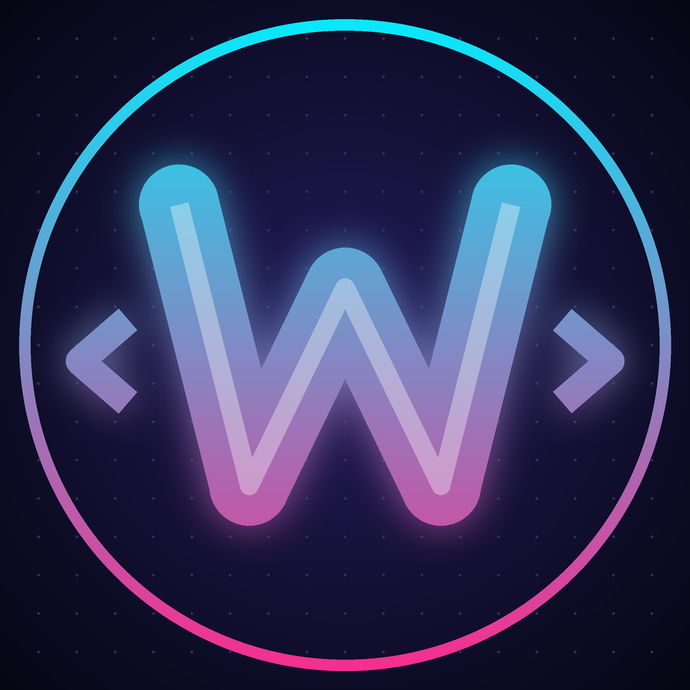

<p align="center">
  
</p>

# 🌐 WebLang — The Complete Web Ecosystem

**Version:** 1.1

A family of **10 simple languages** that replace the entire web stack — HTML, CSS, JS, JSON, PHP, SVG, Markdown, Text, 3D, and PowerPoint — with **one clean syntax style**.

| # | Language | Full Name | Replaces | Extension |
|---|---|---|---|---|
| 1 | **BTW** | Base Text Web | HTML | `.btw` |
| 2 | **STW** | Style The Web | CSS | `.stw` |
| 3 | **MTWC** | Make The Web Click | JavaScript | `.mtwc` |
| 4 | **IOTW** | Info Of The Web | JSON | `.iotw` |
| 5 | **MOTW** | Media Of The Web | PHP | `.motw` |
| 6 | **IFW** | Image For Web | SVG | `.ifw` |
| 7 | **SMDF** | Show MarkDown Files | Markdown | `.smdf` |
| 8 | **STF** | Show Text Files | Text files | `.stf` |
| 9 | **3DS** | 3D Show | 3D scenes | `.3ds` |
| 10 | **SSITW** | Show Slides In The Web | PPTX | `.ssitw` |

---

## 🆕 What's New in v1.1

| Feature | File | What it does |
|---|---|---|
| Form data reading | MTWC | `get input.id` — read what user typed |
| Multi-page routing | MTWC | `go 'page2.btw'` + `save` / `load` |
| Custom components | BTW | `define` once, `use` anywhere |
| Media attributes | BTW | `vid: URL [autoplay] [mute] [loop]` |
| STW clashes fixed | STW | One official shortcode per property |
| Dynamic data | IOTW | `[act:S]` pulls value from MTWC |
| Server tags | MOTW | `make var(N) = show_vid "url"` |
| Slide styling | SSITW | `slide id = N ([bc:red])` in STW |

---

## 🚀 Quick Start

**`page.btw`**
```
link web.stw
link web.mtwc

title : My App
t.1 "Welcome" [id:1]
btn "Dark Mode" [id:2]
img: photo.jpg
```

**`web.stw`**
```
body([t.a:center],[f.f:Times],[c:white],[bg:black])
```

**`web.mtwc`**
```
btn.id = 2 , connect to 'page.btw':

action(Dark)
  inclick btn:
    if (Dark) == true:
      (Dark) == false
      theme light
    else
      (Dark) == true
      theme dark
```

That's a **full interactive page** in 3 tiny files. 🎉

---

# 📄 1. BTW — Base Text Web

**Extension:** `.btw` · **Replaces:** HTML
**Purpose:** Structure and content of a web page.

## Basic Format

```
title : My Page
t.1 "Welcome"
btn "Click me"
img: photo.jpg
```

## All Tags

### Page Tags
| Tag | What it's for | Example |
|---|---|---|
| `title` | Page title | `title : My Page` |
| `link` | Connect STW / MTWC / IOTW | `link web.stw` |
| `meta` | Page info | `meta author : Ali` |
| `icon` | Browser tab icon | `icon: logo.png` |

### Text Tags
| Tag | What it's for | Example |
|---|---|---|
| `t.1`–`t.6` | Headings (big → small) | `t.1 "Welcome"` |
| `p` | Paragraph | `p "Some words"` |
| `b` | Bold | `b "important"` |
| `i` | Italic | `i "note"` |
| `u` | Underline | `u "text"` |
| `s` | Strikethrough | `s "old"` |
| `code` | Code snippet | `code "print('hi')"` |
| `quote` | Blockquote | `quote "words"` |
| `mark` | Highlight | `mark "highlight"` |
| `small` | Small text | `small "fine print"` |

### Link Tags
| Tag | What it's for | Example |
|---|---|---|
| `a` | Hyperlink (external) | `a "Google" -> https://google.com` |
| `a` | Link to another page | `a "Next" -> page2.btw` |
| `anchor` | Jump to section | `anchor #top` |
| `email` | Email link | `email "mail@site.com"` |
| `phone` | Phone link | `phone "123456"` |

### Media Tags
| Tag | What it's for | Example |
|---|---|---|
| `img` | Image | `img: photo.jpg [w:300] [alt:"Photo"]` |
| `vid` | Video | `vid: 1.mp4 [autoplay] [mute] [loop]` |
| `mus` | Music | `mus: music.mp3 [loop] [volume:0.5]` |
| `gif` | GIF | `gif: fun.gif` |
| `svg` | SVG icon | `svg: icon.svg` |
| `iframe` | Embed page | `iframe: https://site.com` |

#### Media Attributes
| Attribute | Applies to | What it does |
|---|---|---|
| `[autoplay]` | `vid`, `mus` | Auto start |
| `[mute]` | `vid` | Start muted |
| `[loop]` | `vid`, `mus` | Repeat forever |
| `[controls]` | `vid`, `mus` | Show play/pause |
| `[w:?]` `[h:?]` | `img`, `vid` | Width / height |
| `[alt:"?"]` | `img` | Alt text |
| `[volume:?]` | `mus` | Volume 0.0–1.0 |
| `[poster:"?"]` | `vid` | Thumbnail |

### Button Tags
| Tag | What it's for | Example |
|---|---|---|
| `btn` | Button | `btn "Click me"` |
| `btn.icon` | Button with icon | `btn.icon "★ Save"` |
| `btn.link` | Link button | `btn.link "Go" -> /page` |
| `btn.disabled` | Disabled button | `btn.disabled "Can't click"` |

### Form Tags
| Tag | What it's for | Example |
|---|---|---|
| `form` | Input wrapper | `form [id:1] { ... }` |
| `input` | Text field | `input email [id:1]` |
| `pass` | Password | `pass password [id:2]` |
| `num` | Number | `num age` |
| `date` | Date picker | `date birthday` |
| `textarea` | Multi-line text | `textarea message` |
| `check` | Checkbox | `check "I agree"` |
| `radio` | Radio button | `radio "Yes"` |
| `select` | Dropdown | `select { opt "A" }` |
| `opt` | Dropdown option | `opt "A"` |
| `label` | Input label | `label "Name"` |
| `submit` | Submit button | `submit "Send"` |
| `range` | Slider | `range 0-100` |
| `file` | File upload | `file resume.pdf` |
| `color` | Color picker | `color theme` |

### Layout Tags
| Tag | What it's for | Example |
|---|---|---|
| `box` | Container | `box { ... }` |
| `row` | Horizontal layout | `row { ... }` |
| `col` | Vertical layout | `col { ... }` |
| `grid` | Grid layout | `grid { ... }` |
| `card` | Card | `card { ... }` |
| `header` | Top of page | `header { ... }` |
| `footer` | Bottom of page | `footer { ... }` |
| `nav` | Navigation | `nav { ... }` |
| `section` | Section | `section { ... }` |
| `aside` | Side content | `aside { ... }` |
| `center` | Center content | `center { ... }` |
| `space` | Spacer | `space 20px` |
| `line` | Divider | `line` |

### List Tags
| Tag | What it's for | Example |
|---|---|---|
| `ul` | Bullet list | `ul { li "A" }` |
| `ol` | Numbered list | `ol { li "1" }` |
| `li` | List item | `li "Apple"` |
| `dl` / `dt` / `dd` | Definition list | `dl { dt "Word" dd "Meaning" }` |

### Table Tags
| Tag | What it's for | Example |
|---|---|---|
| `table` | Table | `table { ... }` |
| `tr` | Row | `tr { ... }` |
| `td` | Cell | `td "Data"` |
| `th` | Header cell | `th "Name"` |
| `thead` / `tbody` | Sections | `thead { ... }` |
| `caption` | Table title | `caption "Scores"` |

### Custom Components 🆕
| Keyword | What it's for | Example |
|---|---|---|
| `define Name` | Create component | `define Card { ... }` |
| `use Name` | Use component | `use Card { ... }` |
| `slot` | Placeholder content | `slot` |
| `prop` | Pass a value | `prop title "Hello"` |

### Extra Tags
| Tag | What it's for | Example |
|---|---|---|
| `progress` | Progress bar | `progress 70%` |
| `loading` | Spinner | `loading` |
| `tooltip` | Hover hint | `tooltip "Info"` |
| `badge` | Small label | `badge "New"` |
| `avatar` | Profile picture | `avatar: user.jpg` |
| `clock` | Live clock | `clock` |
| `count` | Counter | `count: 0` |
| `theme` | Dark / light | `theme dark` |
| `lang` | Page language | `lang ar` |
| `comment` | Hidden note | `comment "todo"` |
| `id` | Element id | `btn "Hi" [id:1]` |
| `class` | Group elements | `btn "Hi" [class:main]` |

## BTW Example

```
title : My Portfolio

define Card {
  card {
    img: prop image [w:200]
    t.2 prop title
    p prop text
    btn prop action
  }
}

header {
  nav {
    a "Home" -> page1.btw
    a "Projects" -> page2.btw
    a "Contact" -> page3.btw
  }
}

section {
  t.1 "My Projects"
  row {
    use Card { prop image "a.jpg" prop title "App One" prop text "Cool app." prop action "View" }
    use Card { prop image "b.jpg" prop title "App Two" prop text "Another." prop action "View" }
  }
}

footer {
  p "© 2026 My Portfolio"
}
```

---

# 🎨 2. STW — Style The Web

**Extension:** `.stw` · **Replaces:** CSS
**Purpose:** Styles BTW elements using short, fixed property tags.

## Basic Format

```
body([t.a:center],[f.f:Times],[c:white])
```

## How to Connect

In your `.btw` file:
```
link web.stw
```

## The Rule (v1.1 — Fixed)

**Every CSS property = ONE official shortcode. No levels. No clashes.**

## Full CSS → STW Table

### Color
| CSS | STW | What it does | Example |
|---|---|---|---|
| `color` | `c` | Text color | `[c:white]` |
| `background-color` | `bg` | Background | `[bg:black]` |
| `background-image` | `bg.i` | Bg image | `[bg.i:bg.jpg]` |
| `border-color` | `bd` | Border color | `[bd:red]` |
| `opacity` | `o` | Transparency | `[o:0.5]` |

### Font & Text
| CSS | STW | What it does | Example |
|---|---|---|---|
| `font-family` | `f.f` | Font type | `[f.f:Times]` |
| `font-size` | `f.si` | Text size | `[f.si:20px]` |
| `font-style` | `f.st` | Italic | `[f.st:italic]` |
| `font-weight` | `f.w` | Bold | `[f.w:bold]` |
| `text-align` | `t.a` | Align | `[t.a:center]` |
| `text-decoration` | `t.d` | Underline | `[t.d:underline]` |
| `text-transform` | `t.t` | UPPER | `[t.t:uppercase]` |
| `line-height` | `l.h` | Line spacing | `[l.h:1.5]` |
| `letter-spacing` | `l.s` | Letter space | `[l.s:2px]` |

### Spacing
| CSS | STW | What it does | Example |
|---|---|---|---|
| `margin` | `m` | Outer space | `[m:10px]` |
| `margin-top` | `m.t` | Top outer | `[m.t:20px]` |
| `margin-bottom` | `m.b` | Bottom outer | `[m.b:20px]` |
| `margin-left` | `m.l` | Left outer | `[m.l:10px]` |
| `margin-right` | `m.r` | Right outer | `[m.r:10px]` |
| `padding` | `p` | Inner space | `[p:15px]` |
| `padding-top` | `p.t` | Top inner | `[p.t:10px]` |
| `padding-bottom` | `p.b` | Bottom inner | `[p.b:10px]` |
| `padding-left` | `p.l` | Left inner | `[p.l:10px]` |
| `padding-right` | `p.r` | Right inner | `[p.r:10px]` |
| `gap` | `g` | Flex/grid gap | `[g:10px]` |

### Size
| CSS | STW | What it does | Example |
|---|---|---|---|
| `width` | `w` | Width | `[w:100px]` |
| `height` | `h` | Height | `[h:50px]` |
| `min-width` | `mw` | Min width | `[mw:200px]` |
| `max-width` | `xw` | Max width | `[xw:800px]` |
| `min-height` | `mh` | Min height | `[mh:100px]` |
| `max-height` | `xh` | Max height | `[xh:500px]` |

### Border
| CSS | STW | What it does | Example |
|---|---|---|---|
| `border` | `b` | Full border | `[b:1px solid red]` |
| `border-width` | `b.w` | Thickness | `[b.w:2px]` |
| `border-style` | `b.st` | Solid/dashed | `[b.st:dashed]` |
| `border-radius` | `b.r` | Rounded | `[b.r:8px]` |
| `box-shadow` | `sh` | Shadow | `[sh:2px 2px gray]` |

### Layout
| CSS | STW | What it does | Example |
|---|---|---|---|
| `display` | `d` | Display type | `[d:flex]` |
| `position` | `pos` | Positioning | `[pos:absolute]` |
| `top` | `t` | Top offset | `[t:10px]` |
| `bottom` | `bo` | Bottom offset | `[bo:10px]` |
| `left` | `le` | Left offset | `[le:10px]` |
| `right` | `ri` | Right offset | `[ri:10px]` |
| `z-index` | `z` | Layer order | `[z:10]` |
| `flex-direction` | `fl.d` | Flex direction | `[fl.d:row]` |
| `justify-content` | `j.c` | Horizontal align | `[j.c:center]` |
| `align-items` | `a.i` | Vertical align | `[a.i:center]` |
| `overflow` | `ov` | Overflow | `[ov:hidden]` |

### Effect
| CSS | STW | What it does | Example |
|---|---|---|---|
| `transition` | `tr` | Smooth change | `[tr:0.3s]` |
| `transform` | `tf` | Rotate/scale | `[tf:rotate(45deg)]` |
| `cursor` | `cu` | Mouse cursor | `[cu:pointer]` |

## STW Example

```
body([t.a:center],[f.f:Times],[c:white],[bg:black])
btn([bg:blue],[c:white],[p:10px],[b.r:5px],[cu:pointer])
img([w:200px],[b.r:10px],[sh:0 4px 8px gray])
```

---

# ⚡ 3. MTWC — Make The Web Click

**Extension:** `.mtwc` · **Replaces:** JavaScript
**Purpose:** Logic and interactivity for BTW pages.

## Basic Format

```
btn.id = 1 , connect to 'web.btw':

action(Dark)
  inclick btn:
    if (Dark) == true:
      (Dark) == false
    else
      (Dark) == true
```

## All Keywords

### Connection
| Keyword | What it's for | Example |
|---|---|---|
| `.id = ?` | Give an id | `btn.id = 1` |
| `connect to 'file.btw':` | Link to page | `connect to 'web.btw':` |
| `link` | Attach MTWC | `link extra.mtwc` |

### Actions
| Keyword | What it's for | Example |
|---|---|---|
| `action(Name)` | Define action | `action(Dark)` |
| `run(Name)` | Call action | `run(Dark)` |
| `stop(Name)` | Stop action | `stop(Dark)` |
| `repeat(N):` | Repeat N times | `repeat(3):` |
| `loop:` | Loop forever | `loop:` |
| `wait(N):` | Pause N sec | `wait(2):` |
| `end` | Close block | `end` |
| `define(Name)` | Define block | `define(Save)` |
| `use(Name)` | Use block | `use(Save)` |

### Events
| Keyword | What it's for | Example |
|---|---|---|
| `inclick ?` | On click | `inclick btn:` |
| `inload ?` | On page load | `inload page:` |
| `inhover ?` | On hover | `inhover btn:` |
| `inleave ?` | On leave | `inleave btn:` |
| `intype ?` | On typing | `intype input:` |
| `insubmit ?` | On submit | `insubmit form:` |
| `inscroll ?` | On scroll | `inscroll page:` |
| `inkey ?` | On key press | `inkey Enter:` |
| `inchange ?` | On value change | `inchange input:` |

### Form Data Reading 🆕
| Keyword | What it's for | Example |
|---|---|---|
| `get input.id` | Read one input | `get input.4` |
| `get form.id` | Read all fields | `get form.1` |
| `clear input.id` | Empty input | `clear input.4` |
| `clear form.id` | Empty form | `clear form.1` |

### Logic
| Keyword | What it's for | Example |
|---|---|---|
| `if (?) == true:` | If true | `if (Dark) == true:` |
| `if (?) == false:` | If false | `if (Dark) == false:` |
| `if (?) > ?:` | Greater | `if (count) > 10:` |
| `if (?) < ?:` | Less | `if (count) < 0:` |
| `if (?) == "?":` | Text match | `if (name) == "Ali":` |
| `else if:` | Another check | `else if (count) == 5:` |
| `else` | Otherwise | `else` |
| `and` / `or` / `not` | Logic | `if (a) == true and (b) == true:` |

### Variables
| Keyword | What it's for | Example |
|---|---|---|
| `var name = ?` | Create variable | `var count = 0` |
| `(?) == ?` | Set value | `(count) == 5` |
| `(?) == (?) + 1` | Add | `(count) == (count) + 1` |
| `(?) == (?) - 1` | Subtract | `(count) == (count) - 1` |

### Save / Load (Multi-page) 🆕
| Keyword | What it's for | Example |
|---|---|---|
| `save name` | Save variable | `save count` |
| `load name` | Load variable | `load count` |
| `save name to 'page2'` | Save for page | `save count to 'page2'` |
| `load name from 'page1'` | Load from page | `load count from 'page1'` |

### Output
| Keyword | What it's for | Example |
|---|---|---|
| `show ?` | Display value | `show (count)` |
| `alert ?` | Popup | `alert "Hello!"` |
| `log ?` | Console print | `log (count)` |
| `set ?` | Change text | `set t.1 "New title"` |
| `hide ?` / `reveal ?` | Hide / show | `hide box` |
| `color ?` / `size ?` | Change style | `color btn "red"` |

### Style Control
| Keyword | What it's for | Example |
|---|---|---|
| `theme dark` / `theme light` | Mode | `theme dark` |
| `class add ?` / `class remove ?` | Classes | `class add btn "active"` |

### Math & Time
| Keyword | What it's for | Example |
|---|---|---|
| `+ - * / %` | Math | `(a) + (b)` |
| `random(?,?)` | Random | `random(1,10)` |
| `now` / `today` | Time | `show now` |
| `timer(N)` / `wait(N):` | Countdown | `timer(10)` |

### Page Navigation 🆕
| Keyword | What it's for | Example |
|---|---|---|
| `go 'page.btw'` | Navigate | `go 'page2.btw'` |
| `back` | Go back | `back` |
| `reload` | Reload page | `reload` |
| `open 'url'` | Open URL | `open 'https://google.com'` |

## MTWC Example — Login Form

**`page.btw`**
```
link web.mtwc

title : Login
form [id:1] {
  input email [id:4]
  pass password [id:5]
  btn "Login" [id:3]
}
t.1 "Welcome back!" [id:6]
```

**`web.mtwc`**
```
btn.id = 3 , connect to 'page.btw':

action(Login)
  inclick btn:
    if get input.4 == "" or get input.5 == "":
      alert "Fill all fields!"
    else
      set t.1 "Welcome, {get input.4}!"
      clear form.1
```

---

# 📦 4. IOTW — Info Of The Web

**Extension:** `.iotw` · **Replaces:** JSON
**Purpose:** Stores data and connects it to MTWC logic.

## Basic Format

```
(Name : Hazem , Age : 13)
```

## How to Connect to MTWC

```
link web.mtwc
(Name : [act:S] , Age : 13)
```

`[act:S]` = value comes from MTWC action `S`.

## Syntax Rules
| Symbol | Meaning | Example |
|---|---|---|
| `( ... )` | Data block | `(Name : Ali)` |
| `Key : Value` | One pair | `Age : 13` |
| `,` | Separate pairs | `(A : 1 , B : 2)` |
| `[act:X]` | Value from MTWC | `Name : [act:S]` |
| `link web.mtwc` | Connect logic | `link web.mtwc` |

## Example

**`data.iotw`**
```
link web.mtwc
(profile : (Name : [act:S] , Age : 13 , Role : "Dev"))
(theme : (mode : dark , color : "blue"))
```

**`web.mtwc`**
```
action(S)
  (Name) == "Hazem"
```

---

# 🖥️ 5. MOTW — Media Of The Web

**Extension:** `.motw` · **Replaces:** PHP
**Purpose:** Server-side logic and dynamic tag creation.

## Basic Format

```
link page.btw
make it (PHP)
make var(1) = show_vid "https://example.com/video.mp4"
```

## Syntax Rules
| Keyword | Meaning | Example |
|---|---|---|
| `link page.btw` | Target page | `link page.btw` |
| `make it (PHP)` | Server mode | `make it (PHP)` |
| `make it (MTWC)` | JS server mode | `make it (MTWC)` |
| `make var(N)` | Create tag #N | `make var(1)` |
| `show_vid "url"` | Create video tag | `show_vid "https://..."` |
| `# comment` | Note | `# this is a note` |

## Example

**`server.motw`**
```
link page.btw

make it (PHP)
make var(1) = show_vid "https://example.com/intro.mp4"
make var(2) = show_text "Welcome to my site"
```

---

# 🖼️ 6. IFW — Image For Web

**Extension:** `.ifw` · **Replaces:** SVG
**Purpose:** Draw vector graphics with simple tags.

## Basic Format

```
circle: r=50 c=red
line: from(0,0) to(100,100)
```

## All Shapes
| Tag | What it draws | Example |
|---|---|---|
| `circle` | Circle | `circle: r=50 c=red` |
| `square` | Square | `square: s=100 c=blue` |
| `rect` | Rectangle | `rect: w=200 h=100 c=green` |
| `line` | Line | `line: from(0,0) to(100,100) c=black` |
| `triangle` | Triangle | `triangle: s=80 c=yellow` |
| `star` | Star | `star: s=50 c=gold` |
| `polygon` | Custom | `polygon: points(0,0 50,0 25,50) c=red` |
| `text` | Text label | `text: "Hi" x=10 y=20 c=black` |
| `path` | Free path | `path: M0,0 L50,50 c=blue` |

## Example

```
circle: r=40 c=blue
text: "W" x=35 y=50 c=white
```

---

# 📝 7. SMDF — Show MarkDown Files

**Extension:** `.smdf` · **Replaces:** Raw markdown
**Purpose:** Display Markdown as styled web content.

## Basic Format

```
show file.md
```

## All Options
| Option | What it does |
|---|---|
| `[toc]` | Table of contents |
| `[code]` | Code highlighting |
| `[tables]` | Table support |
| `[images]` | Show images |
| `[links]` | Clickable links |
| `[scroll]` | Scrollable |
| `theme dark` / `light` | Color mode |
| `maxw 800px` | Max width |

## Example

```
theme dark
maxw 900px
show readme.md [toc] [code] [tables] [images] [links] [scroll]
```

---

# 📄 8. STF — Show Text Files

**Extension:** `.stf` · **Replaces:** Raw text files
**Purpose:** Display plain text files in the browser.

## Basic Format

```
show notes.txt
```

## All Options
| Option | What it does |
|---|---|
| `[wrap]` | Wrap long lines |
| `[scroll]` | Scrollable |
| `[linenums]` | Line numbers |
| `font mono` / `sans` | Font type |
| `size 16px` | Font size |
| `color white` | Text color |
| `bg black` | Background |
| `maxw 800px` | Max width |

## Example

```
font mono
size 14px
color #eee
bg #111
maxw 900px
show logs.txt [linenums] [scroll] [wrap]
```

---

# 🧊 9. 3DS — 3D Show

**Extension:** `.3ds` · **Replaces:** 3D scene files
**Purpose:** Build 3D scenes with simple tags.

## Basic Format

```
scene {
  cube: size=100 c=red
  light: top
  camera: front
}
```

## All Shapes
| Tag | What it draws | Example |
|---|---|---|
| `cube` | Cube | `cube: size=100 c=red` |
| `sphere` | Sphere | `sphere: r=50 c=blue` |
| `plane` | Ground | `plane: w=500 h=500 c:gray` |
| `cylinder` | Cylinder | `cylinder: r=30 h=100 c=green` |
| `cone` | Cone | `cone: r=30 h=80 c=yellow` |
| `torus` | Donut | `torus: r=50 t=10 c=pink` |
| `model` | Load 3D model | `model: car.glb` |

## All Lights & Cameras
| Light | Camera |
|---|---|
| `light: top` | `camera: front` |
| `light: front` | `camera: top` |
| `light: side` | `camera: side` |
| `light: sun` | `camera: orbit` |
| `light: point` | `camera: free` |
| `light: none` | — |

## Attributes
| Attribute | What it does |
|---|---|
| `[spin]` | Auto-rotate |
| `[click]` | Clickable |
| `rotate: 45` | Rotate by degrees |
| `move: x=10 y=0 z=0` | Move in 3D |

## Example

```
scene {
  plane: w=1000 h=1000 c:#222
  cube: size=100 c=red [spin]
  sphere: r=60 c=blue
  light: sun
  camera: orbit
}
```

---

# 📽️ 10. SSITW — Show Slides In The Web

**Extension:** `.ssitw` · **Replaces:** PPTX
**Purpose:** Build slide presentations in the browser.

## Basic Format

```
slide 1 {
  title "Welcome"
  text "My presentation"
}
```

## Syntax Rules
| Keyword | Meaning | Example |
|---|---|---|
| `slide N { }` | A slide | `slide 1 { ... }` |
| `title "?"` | Slide title | `title "Welcome"` |
| `text "?"` | Slide text | `text "Hello"` |
| `img: ?` | Slide image | `img: photo.jpg` |
| `vid: ?` | Slide video | `vid: clip.mp4` |
| `bullet { }` | Bullet list | `bullet { li "A" }` |

## Custom Slide Styles (in STW)

```
slide id = 1 ([bc:red],[c:white])
slide id = 2 ([bc:blue],[c:white])
```

Works the same as `slide([bg:red])`.

## Example

**`talk.ssitw`**
```
slide 1 {
  title "WebLang"
  text "The future of the web"
}

slide 2 {
  title "Why?"
  bullet {
    li "No HTML"
    li "No CSS"
    li "No JS"
  }
}

slide 3 {
  title "Demo"
  vid: demo.mp4 [controls]
}
```

**`talk.stw`**
```
slide id = 1 ([bc:black],[c:white],[t.a:center])
slide id = 2 ([bc:#222],[c:#eee])
slide id = 3 ([bc:navy],[c:white])
```

---

# 🔗 How All Files Work Together

```
┌─────────────────────────────────────────────┐
│  page.btw                                   │
│  ├── structure & content                    │
│  ├── link web.stw    ────┐                  │
│  ├── link web.mtwc   ────┼──┐               │
│  ├── link data.iotw  ────┼──┼──┐            │
│  └── link server.motw ───┼──┼──┼──┐         │
└──────────────────────────┼──┼──┼──┼─────────┘
                           │  │  │  │
              ┌────────────┘  │  │  └────────────┐
              ▼               ▼  ▼               ▼
      ┌──────────────┐ ┌──────────────┐ ┌──────────────┐
      │  web.stw     │ │  web.mtwc    │ │  server.motw │
      │  styles      │ │  logic       │ │  server tags │
      └──────────────┘ └──────────────┘ └──────────────┘
                       ▲
                       │
              ┌────────┴────────┐
              ▼                 ▼
      ┌──────────────┐ ┌──────────────┐
      │  data.iotw   │ │  logo.ifw    │
      │  data        │ │  graphics    │
      └──────────────┘ └──────────────┘
```

---

# 📋 Master Cheat Sheet

```
BTW:     title · t.1–t.6 · p · btn · img: · vid: · mus:
         a "text" -> url · [id:N] · link · define/use

STW:     [prop:value] · [a:v],[b:v]
         c · bg · bd · f.f · f.si · f.st · t.a · p · m · b.r

MTWC:    btn.id = N , connect to 'page.btw':
         action · inclick · if · else · var · set · get input.N
         go 'page.btw' · save · load · define · use

IOTW:    (Key : Value , Key : Value)
         [act:S] · link web.mtwc

MOTW:    link page.btw
         make it (PHP) · make var(N) = show_vid "url"

IFW:     circle: r=? c=? · rect: w=? h=? c=?
         line: from(x,y) to(x,y) · text: "?" x=? y=?

SMDF:    show file.md [toc] [code] [tables] [scroll]
         theme dark · maxw 800px

STF:     show file.txt [wrap] [scroll] [linenums]
         font mono · size 16px · bg black

3DS:     scene { cube: size=? c=? light: top camera: front }
         [spin] [click] · rotate: ? · move: x=? y=? z=?

SSITW:   slide N { title "?" text "?" img: ? }
         slide id = N ([bc:red],[c:white])
```

---

# ✅ Common Mistakes (All Languages)

| Mistake | Fix |
|---|---|
| Media without colon | `img: photo.jpg` ✅ |
| Text without quotes | `btn "Click me"` ✅ |
| Forgot `link web.stw` | add to `.btw` file |
| Forgot `link web.mtwc` | add to `.btw` file |
| Forgot `[id:1]` in BTW | add it to the element |
| Forgot `connect to 'web.btw':` | add at top of MTWC |
| `if` without colon | `if (x) == true:` ✅ |
| `=` instead of `==` in if | `if (x) == true:` ✅ |
| STW clash | use official v1.1 tag |
| IOTW without `( )` | `(Name : Ali)` ✅ |
| MOTW without `make it (...)` | `make it (PHP)` ✅ |
| IFW without `:` | `circle: r=50` ✅ |
| 3DS without `scene { }` | wrap in `scene { }` ✅ |
| SSITW without `slide N` | `slide 1 { }` ✅ |

---

# 🎯 Learn in 60 Seconds

```
1. Structure  → page.btw
2. Style      → web.stw     (link in BTW)
3. Logic      → web.mtwc    (link + connect in BTW)
4. Data       → data.iotw   (link in BTW)
5. Server     → server.motw (link page.btw)
6. Graphics   → logo.ifw    (link in BTW)
7. Markdown   → docs.smdf   (show file.md)
8. Text       → logs.stf    (show file.txt)
9. 3D         → model.3ds   (scene { })
10. Slides    → talk.ssitw  (slide N { })

Style format → [prop:value]
Logic format → inclick / if / (state) == value
```

**That's WebLang. 10 languages. 1 syntax. Zero boilerplate.** 🎉
